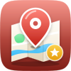
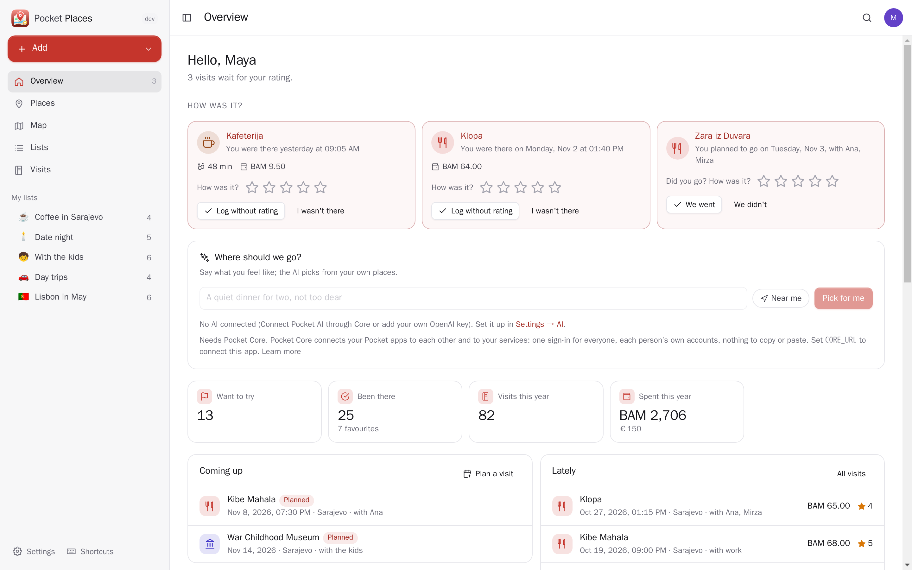
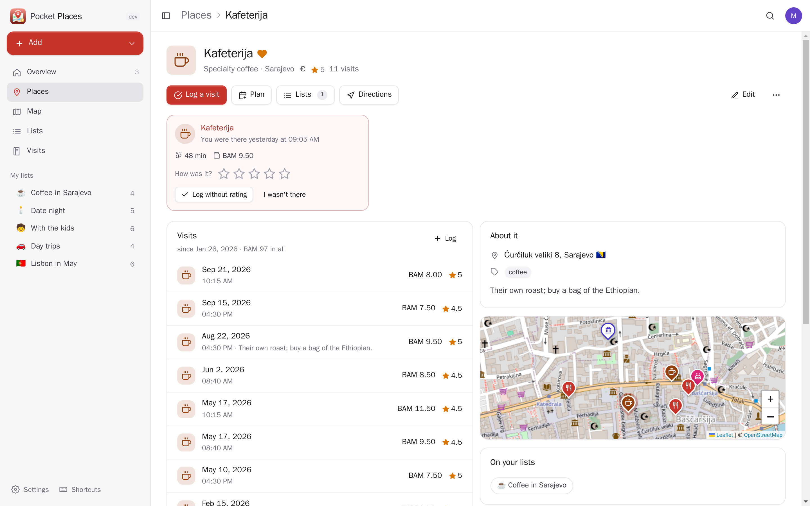
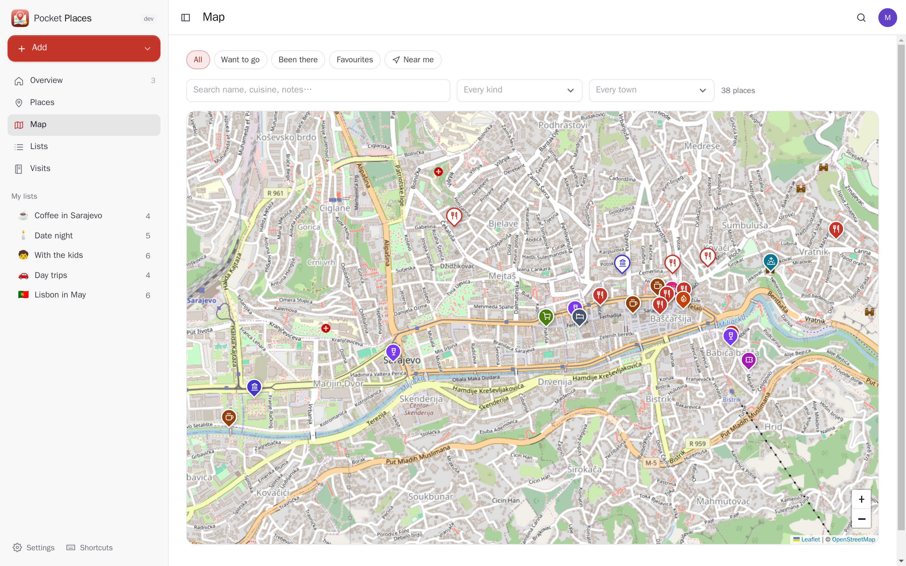
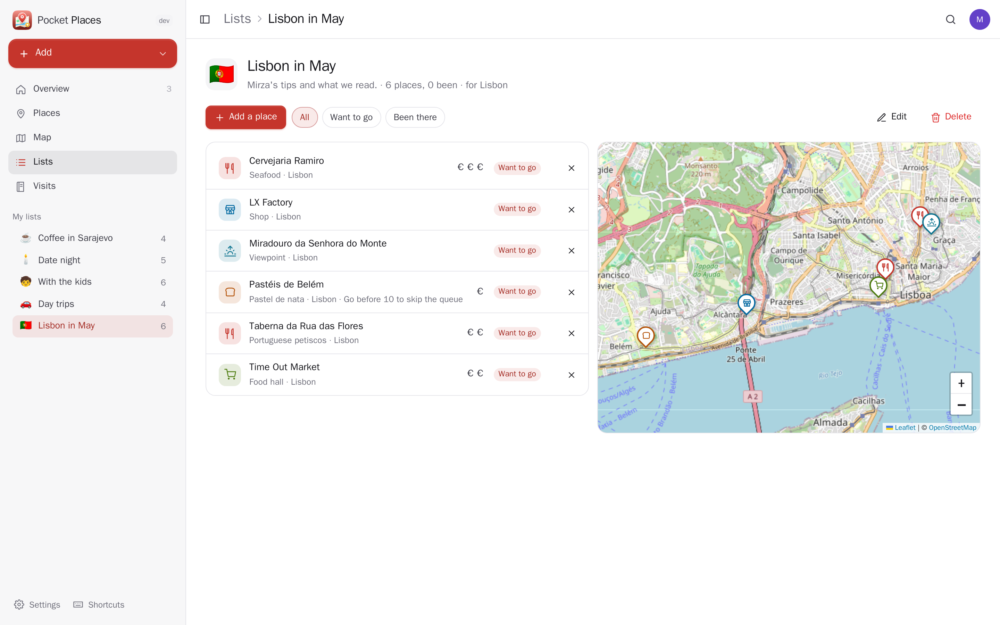
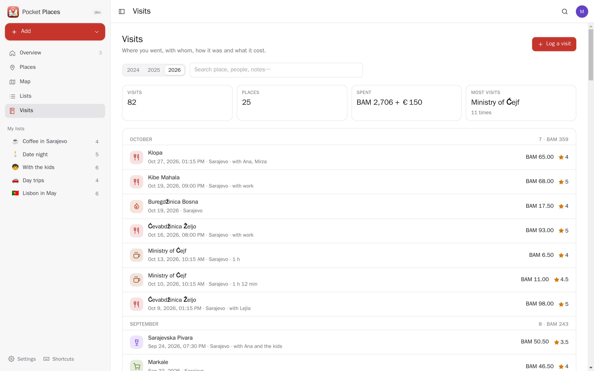
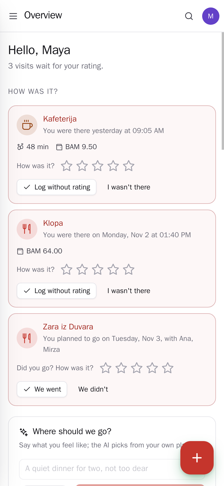
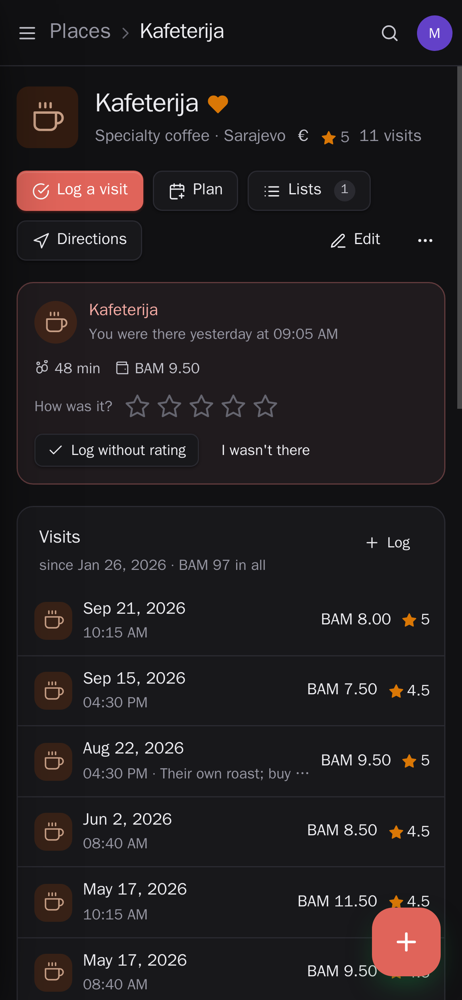

<p align="center"></p>
<h1 align="center">Pocket Places</h1>
<p align="center">The places you love and the ones you want to try, on your own server: restaurants, cafés, bars, bakeries, museums, parks, beaches and viewpoints on a list and a map, each with your rating, the price, notes, opening hours and who recommended it; your own lists (coffee in town, date night, a trip); every visit with whom you went, how it was and what it cost; and plans that go on your calendar. With Pocket Movement and Pocket Money connected it notices when you were at one of your places and asks "how was it?". Bring everything in from Google Maps.<br>One Go binary, one SQLite file, one volume. Part of the Pocket apps; works on its own too.</p>
<p align="center">
  <a href="https://github.com/abjelosevic88/pocket-homelab-places/actions"></a>
  <a href="https://github.com/abjelosevic88/pocket-homelab-places/pkgs/container/pocket-homelab-places"></a>
  <a href="LICENSE"></a>
</p>

---

<p align="center"></p>

<table>
  <tr>
    <td width="50%"></td>
    <td width="50%"></td>
  </tr>
  <tr>
    <td align="center"><sub>Every place with its visits, what they cost, how often Pocket Movement saw you there, its details and what is close by.</sub></td>
    <td align="center"><sub>All your places on one map, with the same filters as the list: want to go, been there, favourites, near me.</sub></td>
  </tr>
  <tr>
    <td width="50%"></td>
    <td width="50%"></td>
  </tr>
  <tr>
    <td align="center"><sub>Your own lists, with notes per place; a list can be for a trip in Pocket Travel.</sub></td>
    <td align="center"><sub>Every visit, month by month, with whom and what it cost.</sub></td>
  </tr>
  <tr>
    <td width="50%"></td>
    <td width="50%"></td>
  </tr>
  <tr>
    <td align="center"><sub>Made for the phone: rate a visit with one tap, the + button adds a place or logs a visit.</sub></td>
    <td align="center"><sub>Light and dark follow the system.</sub></td>
  </tr>
</table>

## What it does

- **Places**: kind (restaurant, café, bar, bakery, street food, dessert, market, shop, museum, sight, park, viewpoint, beach, nature, something to do, a stay), cuisine, want to go or been there, favourite, your rating, price (€ to €€€€), address and spot, website, phone, opening hours, tags, who recommended it, notes. Closed for good keeps it without suggesting it.
- **Adding one is quick**: type the name and the town and pick it from OpenStreetMap (address, spot, website and hours filled in), paste a Google Maps or Apple Maps link, or tap "I'm here".
- **Visits and plans**: the day and time, how it was, with whom, how long, what it cost, notes. A plan goes on your calendar; when its day has passed Places asks whether you went. A place's rating is the average of your rated visits.
- **"How was it?"**: every half hour Places looks at your own Pocket Movement stays and Pocket Money payments of the last days; a stay of 20 minutes or more at one of your places, or a payment there (at its spot or under its name), becomes one card per place and day, with a push. One tap on the stars logs the visit, the payment linked instead of booked twice. Nothing is logged until you answer; a dismissed one never comes back.
- **Lists** of your own, with a note per place and a map; a list can be for a trip.
- **The map**: every place, filled pins where you have been, outlined where you want to go, one colour per kind; near me sorts by distance.
- **Where should we go?**: say what you feel like ("a quiet dinner for two, not too dear", near me) and the AI picks up to three of your own places with one sentence each. Only the places' own fields are sent, never your visits, people or money.
- **From Google Maps**: Google Takeout's Saved Places, Reviews (with your stars and words, as visits) and each saved list's CSV (it becomes a list of the same name). Any CSV with a header row works too. Importing twice adds nothing.
- **Everyone their own**: each person has their own places, visits, lists, settings and connections; admins see no one else's.
- **Export** as JSON (and back in, idempotent) or as CSV, a whole-database backup for admins.

## Run it

```sh
docker run -d --name pocket-places -p 8080:8080 -v ./data:/data \
  -e BASE_URL=https://places.example.com -e SECURE_COOKIES=true \
  ghcr.io/abjelosevic88/pocket-homelab-places:latest
```

or `docker compose up -d` with [docker-compose.yml](docker-compose.yml). Open it, create the first account and add a place. All options: [docs/configuration.md](docs/configuration.md). API: [docs/api.md](docs/api.md).

## With Pocket Core

Set `CORE_URL` and `CORE_REGISTRATION_KEY` and Places joins the box: people sign in with Pocket Core, and through app links each person's places reach their own Pocket apps with nothing to paste:

| App | What Places does there | Scopes |
|---|---|---|
| Pocket Movement | notices when you stayed at one of your places ("how was it?"); a place's page shows how often you have been there | `movement:read` |
| Pocket Money | finds what you paid at a place to go with the visit; can book what a visit cost as a transaction (edits follow, delete removes it) | `transactions:read`, `accounts:read`, `transactions:write` |
| Pocket Calendar | a planned visit as an event with the address, moved when the plan changes | `calendar:read`, `calendar:write` |
| Pocket Contacts | who recommended a place, who came along | `contacts:read` |
| Pocket Travel | coming trips with the places on your list at the destination; lists for a trip; visits filed with their trip | `trips:read` |
| Pocket Split | "Split the bill" adds a visit's cost to one of your groups, shared evenly | `groups:read`, `expenses:write` |
| Pocket AI | "where should we go?"; the Ask button on every page | inference |

Other apps can read your places (`places:read`: Pocket AI's "where did we have that lamb?", Pocket Day's journal, the places on a trip in Pocket Travel) or add for you (`places:write`: save a place, log or plan a visit; it may change only what it added). Events on the bus: `places.place_saved`, `places.visit_logged`, `places.visit_planned`, `places.to_rate`, `places.list_saved`. Without Core every connection can be made directly with a URL and a token; the Core-only choices stay visible, greyed out.

## Develop

```sh
make dev     # API on :8080 with demo data + Vite on :5173
make test    # go vet, go test, tsc
make         # web + binary
```

MIT licensed. Maps © OpenStreetMap contributors; place search by OpenStreetMap Nominatim.
